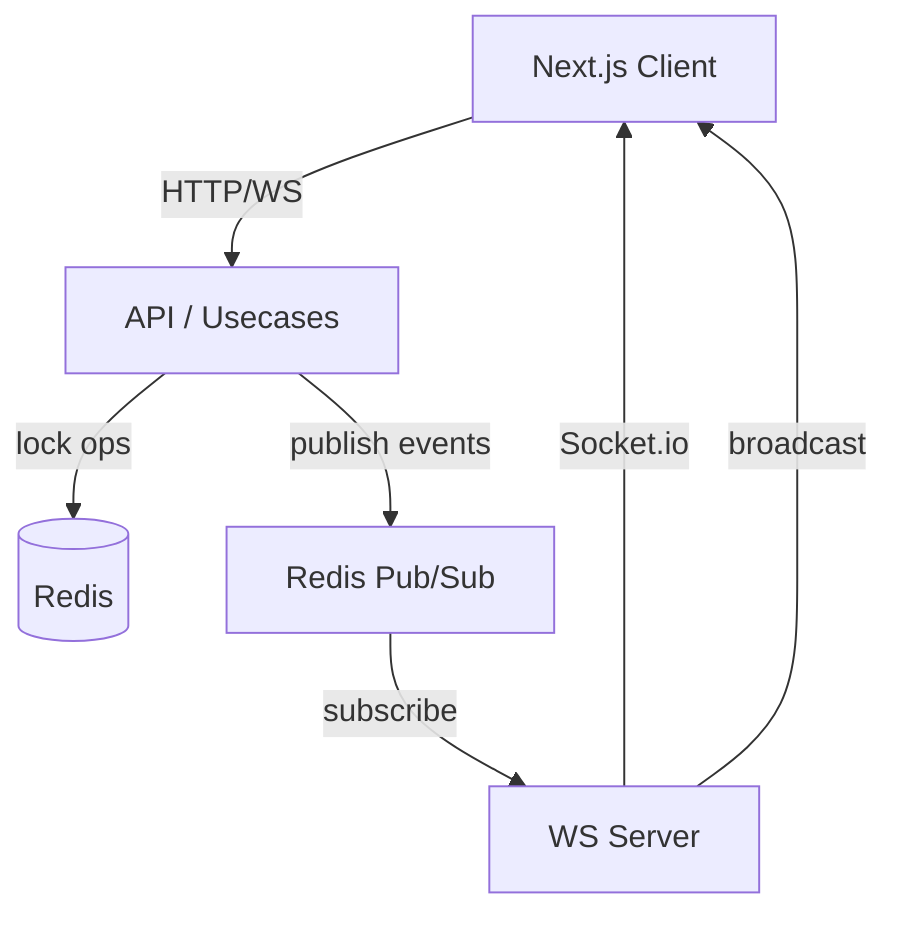
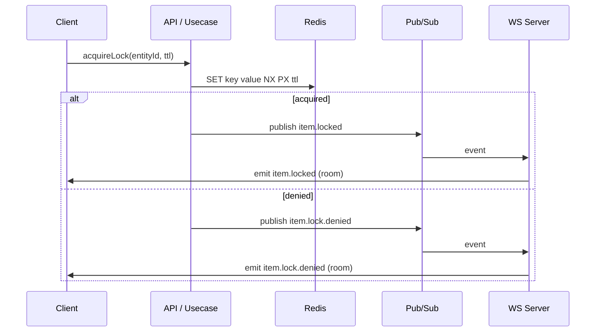
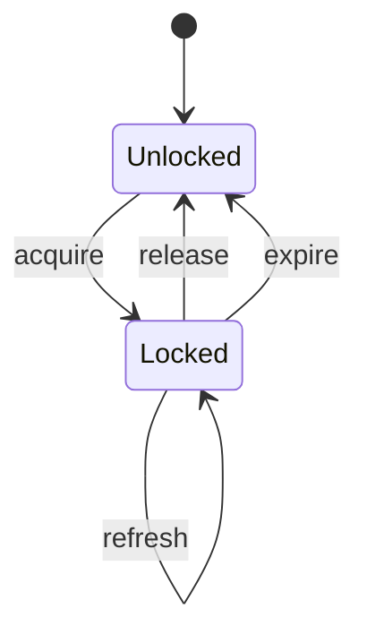

# Realtime Locking (Redis + WebSockets)

This document describes the realtime, tenant‑safe, entity‑scoped locking system for the inventory management SaaS.  
It is designed to prevent conflicting edits and to show edit presence in realtime.

**Implementation plan (TDD tasks, definition of done, edge cases):** [IMPLEMENTATION_PLAN.md](./IMPLEMENTATION_PLAN.md)

**Sequence diagram:** [FLOW.mermaid](./FLOW.mermaid)

---

## Goals

- **Per‑entity locking** (item 1 doesn’t block item 2)
- **Tenant isolation** (store A never sees store B events)
- **Realtime presence** (who is editing)
- **Safe distributed locking** (token-based, no stale unlock)
- **Simple, testable, hexagonal architecture**
- **Functional style** (no heavy OOP)

---

## Architecture Overview

**Core components**

- **LockServicePort** → distributed lock abstraction
- **Redis Lock Adapter** → uses `SET NX PX`, Lua for safe release
- **Domain Events** → published when lock is acquired/denied/released
- **Redis Pub/Sub** → transports events
- **WS Server** → listens and broadcasts to Socket.io rooms
- **Next.js Client** → joins store/item rooms and updates UI

---

##  High-Level Flow

1. Admin opens edit page.
2. Client joins rooms:
   - `store:{storeId}`
   - `store:{storeId}:item:{itemId}`
3. Client requests lock.
4. Backend attempts lock (Redis).
5. Event published:
   - `item.locked` / `item.lock.denied`
6. WS server broadcasts to item room.
7. Other clients update UI.

---

## Room Strategy (Required)

| Scope | Room | Purpose |
|------|------|---------|
| Tenant | `store:{storeId}` | store-wide events |
| Entity | `store:{storeId}:item:{itemId}` | item edit presence |
| Admin | `admin:{adminId}` | direct user events |

---

## Lock Key Strategy

Lock keys must be centralized:

```ts
export const LockKeys = {
  item(storeId: string, itemId: string): LockKey {
    return brand(`store:${storeId}:item:${itemId}`);
  },
};
```

---

## Lock Ownership Model

Lock value should include **token** + metadata:

```json
{
  "storeId": "store-1",
  "itemId": "item-1",
  "lockedBy": "admin-1",
  "lockedByName": "Jack",
  "token": "uuid",
  "expiresAt": "2026-05-14T10:00:00Z"
}
```

Token prevents stale unlocks.

---

## Lock Lifecycle

1. **Acquire**
   - `SET key value NX PX ttl`
2. **Refresh**
   - compare token + extend TTL
3. **Release**
   - Lua compare-and-delete
4. **Expire**
   - Redis TTL fallback

---

## Domain Events

Recommended events:

- `item.locked`
- `item.lock.denied`
- `item.unlocked`
- `item.lock.expired`

Payload:

```ts
{
  storeId,
  itemId,
  lockedBy,
  lockedByName,
  expiresAt,
  token?
}
```

---

## Current Generic Use Cases

You already built:

- `buildAcquireLockUsecase`
- `buildReleaseLockUsecase`
- `buildRefreshLockUsecase`

These are good foundations. They expect:
- a lock key builder
- a lock service
- optionally an event publisher + event factory

---

## Mermaid Diagrams

### 1) Component Architecture



---

### 2) Lock Acquire Sequence



---

### 3) Lock State Machine



---

## Known Gaps / TODOs

Your current implementation has some unsafe or incomplete parts:

### Redis Lock Adapter

**Problems**
- lock value currently uses `lockedBy: token` (confusing)
- `release` uses actorId instead of token
- no atomic release script
- `get()` returns `ok: true` even if lock not owned

**Required Fixes**
- lock value must include `token`
- release must compare token
- use Lua compare/delete to avoid races
- always return correct `LockResult`

---

### WS Room Join Mismatch

Client emits:
```ts
socket.emit("store:join", storeId)
```

Server listens for:
```ts
socket.on("join-store", ...)
```

Must be consistent.

---

### 🔴 WS Event Transport

Your Next.js app publishes domain events to Redis via `buildRedisEventPublisher`, while the ws-server subscribes.

This is correct, but you also have a `buildWsEventPublisher` which directly broadcasts to WS.  
Choose **one strategy** to avoid duplicate or missing events.

---

## Recommended File Cleanup

Keep only:

- Redis event **publisher** in API
- Redis event **subscriber** in ws-server
- WS server **broadcast logic**
- WS client **room join** functions

---

## Required Config

```bash
PORT=3001
REDIS_URL=redis://localhost:6379
DOMAIN_EVENTS_CHANNEL=domain-events
NEXT_PUBLIC_WS_URL=http://localhost:3001
```

---

## Minimal Run

1) Start Redis
```bash
redis-server
```

2) Run ws-server
```bash
pnpm ws-server
```

3) Run Next.js app
```bash
pnpm dev
```

---

## Testing Plan

### Unit Tests
- acquire success
- acquire denied
- release with correct token
- release with stale token
- refresh with correct token
- refresh with stale token

### Integration Tests
- lock + event published
- redis pub/sub → ws room broadcast
- isolation: cross‑store must not receive events

---

## Example Room Join

```ts
// client
socket.emit("join-store", { storeId });
socket.emit("join-item", { storeId, itemId });
```

```ts
// server
socket.on("join-item", ({ storeId, itemId }) => {
  socket.join(`store:${storeId}:item:${itemId}`);
});
```

---

## Summary

This system ensures:

- Reliable distributed locks
- Safe token‑based ownership
- Realtime presence updates
- Tenant isolation
- Simple composable usecases

The **next step** is to align adapters (Redis lock + WS) with the intended ownership model and room structure.